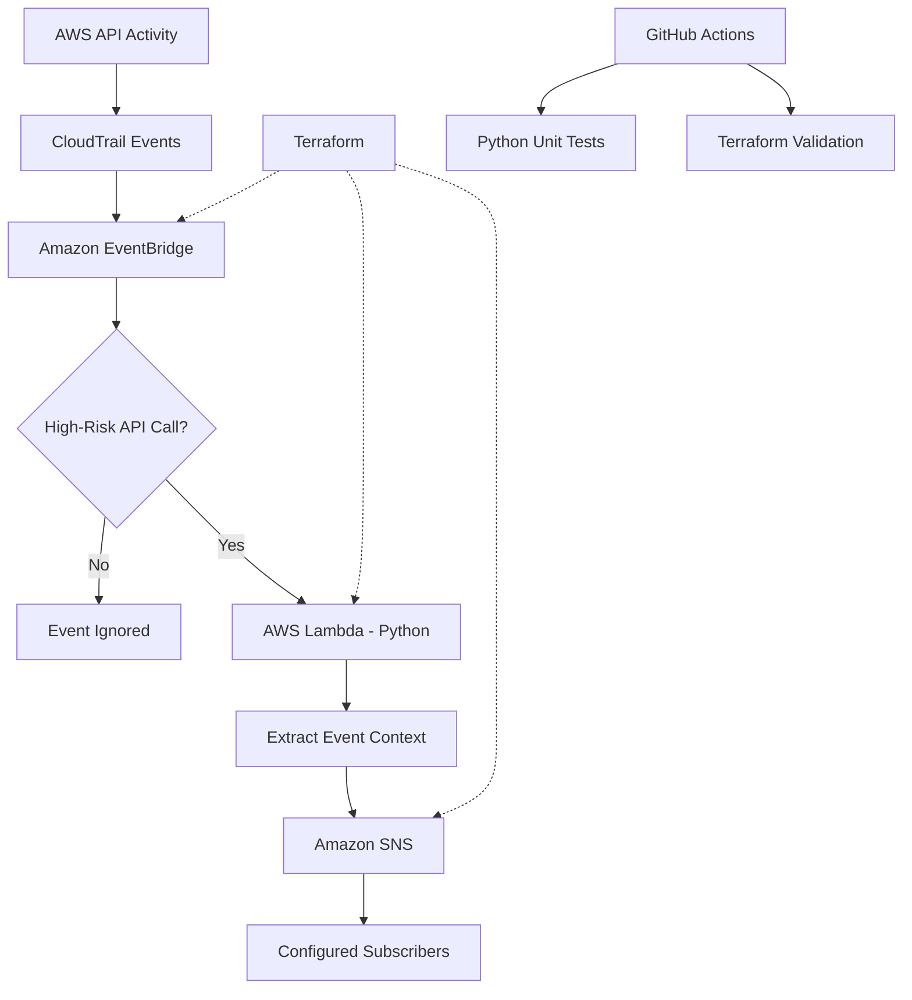

# Serverless CloudWatch Guard

**Event-driven AWS security monitoring and automated alerting using Python, Terraform, CloudTrail, EventBridge, Lambda and SNS.**

A cloud security engineering project designed to detect high-risk AWS control-plane activity, generate contextual security alerts, and demonstrate infrastructure-as-code and secure development practices.

## Architecture



The architecture uses event-driven detection without requiring a continuously running monitoring server.

## The Problem

AWS environments generate security-relevant management events, including IAM identity changes and network configuration modifications.

Manually reviewing these events can delay the identification of potentially malicious activity. Changes such as unexpected IAM user creation or modifications to security group ingress rules may introduce security risks.

Automated event-driven monitoring can reduce the time required to identify and investigate these activities.

## The Solution

Serverless CloudWatch Guard monitors two AWS API operations:

| API Operation | Security Relevance |
|---------------|-------------------|
| `CreateUser` | Creation of new IAM users |
| `AuthorizeSecurityGroupIngress` | Modification of inbound network access rules |

When a matching CloudTrail event reaches EventBridge, a rule invokes an AWS Lambda function.

The Lambda function:

1. Identifies the API operation.
2. Extracts the actor identity and source IP address.
3. Collects the AWS account, region, event ID and timestamp.
4. Constructs a contextual security alert.
5. Publishes the alert to an Amazon SNS topic.

SNS can deliver notifications to configured subscribers or integrate with downstream incident-response workflows.

## Technology Stack

| Technology | Purpose |
|------------|---------|
| Python 3.12 | Security event processing |
| AWS CloudTrail | AWS API activity records |
| Amazon EventBridge | Event filtering and routing |
| AWS Lambda | Serverless detection logic |
| Amazon SNS | Security alert publication |
| Amazon CloudWatch Logs | Application logging |
| Terraform | Infrastructure as Code |
| GitHub Actions | Automated testing and validation |
| Python unittest | Unit testing with mocked AWS services |

## Infrastructure as Code

Terraform defines the cloud infrastructure required for the monitoring solution.

Resources include:

- SNS topic for security alerts.
- Lambda function and execution role.
- IAM policy restricting SNS publishing to the designated topic.
- EventBridge rule and Lambda target.
- EventBridge permission to invoke Lambda.
- Dedicated CloudWatch log group with 14-day retention.
- IAM permissions restricting log writes to the Lambda log group.

The Lambda deployment package is generated using Terraform's `archive_file` data source.

## Security Controls

### Least-Privilege IAM

The Lambda execution role grants only the permissions required for its configured responsibilities:

- `sns:Publish` to the designated SNS topic.
- CloudWatch Logs stream creation and event publishing within its designated log group.

The CloudWatch log group is managed by Terraform rather than created dynamically by the Lambda function.

### Reduced Security Event Logging

Application logs record selected event metadata rather than logging the complete incoming CloudTrail payload.

Detailed alert information is sent to SNS for investigation. Request parameters included in SNS alerts should be reviewed for sensitive information before production use.

### Error Handling

The Lambda raises exceptions when required configuration is missing or AWS operations fail.

This allows Lambda to recognise failed invocations and supports AWS asynchronous failure handling and retry behaviour.

### Log Retention

Terraform configures a dedicated CloudWatch log group with a 14-day retention period.

## Automated Testing

The project uses Python's `unittest` framework with mocked AWS clients.

Four unit tests verify:

1. A monitored `CreateUser` event produces an SNS alert.
2. An unrelated API operation is ignored.
3. Missing SNS topic configuration raises an exception.
4. An SNS publishing failure propagates an exception.

Tests run without AWS credentials or live cloud resources.

### Run Tests Locally

Install dependencies:

```bash
python3 -m pip install -r requirements.txt
```

Run the unit tests:

```bash
python3 -m unittest discover -s tests -v
```

## Continuous Integration

The `.github/workflows/security-ci.yml` workflow performs automated checks on configured pushes and pull requests.

### Python Validation

- Installs Python dependencies.
- Checks Lambda Python syntax.
- Executes automated unit tests.

### Terraform Validation

- Installs Terraform.
- Checks Terraform formatting.
- Initialises the required providers.
- Validates infrastructure configuration.

The jobs run independently and do not deploy resources to AWS.

### Local Terraform Validation

```bash
terraform fmt -check
terraform init -backend=false
terraform validate
```

## Deployment

### Prerequisites

- AWS account with appropriate IAM permissions.
- Terraform CLI.
- AWS CLI credentials configured for a designated test environment.
- An AWS Region selected for deployment.
- An SNS subscription or other notification consumer if alert delivery is required.

### Deployment Commands

After reviewing the configuration, AWS permissions and expected costs:

```bash
terraform init
terraform plan
terraform apply
```

Terraform provisions the defined monitoring resources.

**Important:** Terraform validation does not prove that the infrastructure has been deployed or that AWS events are being delivered successfully.

A functioning deployment also requires appropriate CloudTrail event delivery to EventBridge and a confirmed SNS notification destination.

### Cleanup

When testing is complete, the deployed resources can be removed with:

```bash
terraform destroy
```

Review the plan before approving destruction.

## Validation Status

| Component | Status |
|-----------|--------|
| Python syntax | Validated |
| Lambda unit tests | 4 passing |
| Terraform formatting | Validated |
| Terraform configuration | Validated |
| GitHub Actions CI | Passing |
| Live AWS deployment | Not yet verified |
| End-to-end SNS delivery | Not yet verified |

Infrastructure validation and unit tests have been completed successfully. Live deployment and alert delivery remain separate verification steps.

## Known Limitations

- Detection currently covers two specific AWS API operations.
- The project does not provide a comprehensive cloud threat-detection system.
- SNS requires configured subscribers for notification delivery.
- Event delivery and alert latency have not been benchmarked.
- Alert request parameters may require additional redaction.
- Automated alert deduplication and dead-letter handling are not implemented.
- AWS deployment and end-to-end alert delivery have not yet been verified.

## Future Improvements

- Expand monitoring to additional IAM and networking operations.
- Add EventBridge and Lambda failure destinations or dead-letter queues.
- Introduce alert deduplication and severity classification.
- Add security scanning to GitHub Actions.
- Improve structured logging and alert redaction.
- Integrate alerts with a SIEM or incident-response platform.
- Conduct controlled AWS deployment and end-to-end notification tests.

## Security Framework Alignment

The design supports selected activities associated with the NIST Cybersecurity Framework:

**Detect:** Monitoring security-relevant control-plane changes and identifying potentially suspicious AWS API operations.

**Respond:** Generating contextual alerts to support incident analysis and communication.

This project implements alerting, not automated containment or remediation.

## Project Objective

Serverless CloudWatch Guard demonstrates how event-driven cloud infrastructure, security monitoring and Infrastructure as Code can be combined to support automated security operations.

It also explores DevSecOps engineering practices through automated testing, infrastructure validation, least-privilege permissions and reproducible configuration.
